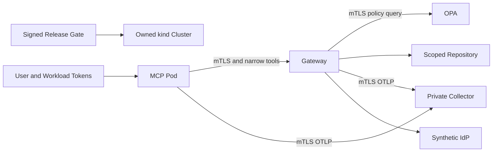

# Deployment Guide

Install Docker/Compose, kubectl and host Python 3.12+. Run `bash scripts/run.sh` from the capstone code directory. Startup builds overlays in order, initializes only missing synthetic fixture secrets with mode 0600, verifies pinned tools and invokes the dedicated kind bootstrap. No user kubeconfig/context is overwritten. Signed release verification precedes deployment.

The Istio workload-security workshop owns `learning-mesh` and `learning-identity-fixtures`. API, MCP and collector use distinct service accounts without Kubernetes API token automount. Strict mTLS and narrow caller/method/path policies protect API, OPA and collector. The synthetic fixture IdP is deliberately non-mesh/local HTTP. Secrets reach Kubernetes via stdin, never printed or committed.

The verified image is loaded under `zero-trust-deployment-readiness-gateway:release-<archive-hash-prefix>`, derived from the signed archive. Workloads have read-only roots, bounded writable areas, probes and resources. The known-good revision is trusted only after live smoke succeeds.

Data is synthetic, in-memory and single-process; rollouts reset it. New developers use the pinned environment/runbook. A second fresh capstone cluster was not created solely to repeat the already executed bootstrap.